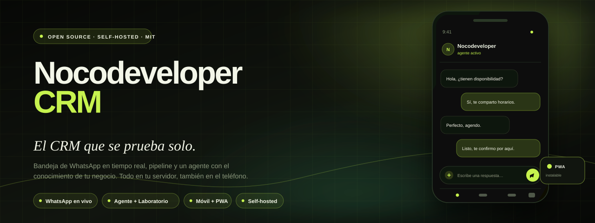
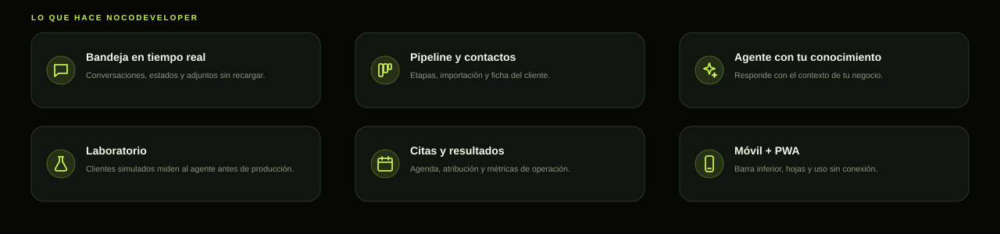

<p align="center">
  
</p>

<p align="center">
  <a href="https://github.com/iamnocodeveloper/nocodeveloper-crm/actions/workflows/ci.yml">
    
  </a>
  <a href="LICENSE">
    
  </a>
  
  
  
  
</p>

<h1 align="center">Nocodeveloper CRM</h1>

<p align="center">
  <strong>El CRM de WhatsApp open source, self-hosted y móvil, con un agente de IA que se pone a prueba solo.</strong>
</p>

---

## Qué es

Nocodeveloper CRM reúne la operación de un negocio que vende por WhatsApp en una sola aplicación: bandeja en tiempo real, pipeline, contactos, agenda, un agente con el conocimiento de tu negocio y un **Laboratorio** donde clientes simulados lo evalúan antes de que hable con personas reales.

Una instancia = un negocio. Todo corre en tu servidor, con tu base de datos y tus archivos. La experiencia móvil está incluida: barra inferior, hojas táctiles, compositor adaptado y PWA instalable.

<p align="center">
  
</p>

## Lo que incluye

| Área | Qué hace |
|---|---|
| **Bandeja** | Conversaciones de WhatsApp en tiempo real, estados enviado/entregado/leído, adjuntos, ventana de 24 h y handoff a humano. |
| **Pipeline y contactos** | Etapas, valores, prioridad, ficha del cliente, importación CSV y contactos sin agente. |
| **Agente de IA** | Perfil, rol, tono y conocimiento del negocio. Puedes conectar tu propio agente por la API `/api/bot/*`. |
| **Laboratorio** | Seis clientes simulados conversan con tu agente; un juez independiente devuelve score, hallazgos y sugerencias. |
| **Citas y resultados** | Agenda universal, disponibilidad, recordatorios, atribución y métricas de operación. |
| **Móvil + PWA** | Navegación inferior, `safe-area`, hojas de adjuntos, contacto y diálogos; instalable y con fallback offline. |
| **White-label** | Nombre, acento, moneda, favicon e iconos por organización desde Ajustes → Marca. |

> **Alcance de esta versión pública:** incluye el core y la experiencia móvil/PWA. Los módulos privados de operación de clientes (bloqueo avanzado de IA, catálogo, ventas y automatizaciones específicas) no forman parte de este repositorio. Así el core comunitario se mantiene simple y el producto de agencia conserva su valor.

## Móvil desde el primer día

- Barra inferior con **Bandeja · Pipeline · Contactos · Citas/Agente · Más**.
- Cajón lateral completo, cierre al navegar y con `Escape`.
- Bandeja maestro-detalle: la lista cede la pantalla al hilo y el panel de detalles entra como cajón.
- Compositor con hoja **+** para archivo, ubicación y contacto; sin robarle ancho al texto.
- Diálogos convertidos en hojas inferiores con asa, scroll interno y `env(safe-area-inset-bottom)`.
- Manifest, service worker, iconos 192/512/maskable y página `/offline`.

## Inicio rápido

### Docker

```bash
git clone https://github.com/iamnocodeveloper/nocodeveloper-crm.git
cd nocodeveloper-crm
cp .env.example .env
# Completa APP_BASE_URL, DATABASE_URL, BETTER_AUTH_SECRET,
# ENCRYPTION_KEY y META_WEBHOOK_VERIFY_TOKEN. El resto es opcional.
docker compose up -d --build
```

Abre `http://localhost:3000`. La primera cuenta se crea desde `/register` (o con `ALLOW_SIGNUP`). Para cargar datos de demostración:

```bash
corepack pnpm install
corepack pnpm seed:demo
```

### Desarrollo local

Requisitos: **Node.js 20+**, **pnpm 11.5.0** (o Corepack) y **PostgreSQL 15+**.

```bash
corepack pnpm install
corepack pnpm init-env
corepack pnpm db:migrate
corepack pnpm seed:demo
corepack pnpm dev
```

La guía completa —variables, canales, migraciones, backups y despliegue— está en **[docs/getting-started.md](docs/getting-started.md)**.

## Canales

- **WhatsApp Cloud API** (Meta) con webhook firmado.
- **WAHA** para sesiones de WhatsApp Web.
- **Instagram, Messenger y TikTok** mediante conectores, si activas `CHANNELS`.
- **Agenda** con Google Calendar, Zoom y conectores propios (`AGENDA=on`).
- **Atribución** Click-to-WhatsApp y CAPI (`ATRIBUCION=on`).

El token de WhatsApp nunca sale del CRM. Las credenciales se guardan cifradas y el agente no recibe la llave.

## Arquitectura

```text
Next.js 15 (App Router) + React 19 + TypeScript
        │
        ├─ PostgreSQL + Drizzle ORM
        ├─ SSE /api/events para tiempo real
        ├─ WhatsApp Cloud API / WAHA / conectores
        ├─ Agente propio o cerebro externo por /api/bot/*
        └─ PWA móvil (manifest + service worker)
```

| Carpeta | Contenido |
|---|---|
| `src/app` | Rutas, layouts, API y páginas |
| `src/components` | Bandeja, pipeline, contactos, ajustes, shell móvil |
| `src/server` | Canales, agente, agenda, laboratorio, datos |
| `src/lib` | Tipos, branding, tema, utilidades, contratos |
| `drizzle/` | Migraciones SQL |
| `docs/` | Guías técnicas y decisiones |
| `scripts/` | Seed, doctor, e2e, utilidades |

## Documentación

- [Primeros pasos](docs/getting-started.md)
- [Migrar a 2.0](docs/migrar-a-2.0.md)
- [Conectores de agenda](docs/agenda-conectores.md)
- [Atribución y CAPI](docs/atribucion-capi.md)
- [MCP](docs/mcp-setup.md)
- [Arquitectura de tres agentes](docs/three-agent-architecture.md)
- [OpenAPI](docs/openapi.json)
- [ADRs](docs/adr-001-canales-opcionales.md)

## Despliegue

La app se puede desplegar con Docker Compose, Render, Fly.io o Railway. Los manifiestos están en el repo y fijan la imagen `ghcr.io/iamnocodeveloper/nocodeveloper-crm:1.0.0`.

### Otras plataformas

- [Render](render.yaml) — Blueprint con Postgres gestionado, disco en `/data` y healthcheck.
- [Fly.io](fly.toml) — imagen, volumen, puerto 3000 y healthcheck; los secretos se fijan con `fly secrets`.
- [Railway](railway.toml) — build por Dockerfile, healthcheck y política de reinicio; base, volumen y variables por CLI.

Para producción:

1. Usa HTTPS (Caddy incluido en `docker-compose.yml` o tu proxy).
2. Define `APP_BASE_URL` con el dominio real.
3. Configura el webhook de Meta/WAHA contra `/api/webhooks/...`.
4. Programa backups de PostgreSQL y del volumen de medios.
5. Revisa `/api/health` y `pnpm doctor`.

## Seguridad

- No publiques `.env`, tokens, teléfonos ni capturas con datos de clientes.
- Rota las llaves si sospechas una exposición.
- El repo incluye `SECURITY.md` con el canal de reporte.
- Las migraciones y los secretos se manejan fuera del control de versiones.

## Licencia

MIT. Consulta [LICENSE](LICENSE).

## Contribuir

1. Abre un issue con el caso de uso o el bug.
2. Crea una rama corta y enfocada.
3. Ejecuta `corepack pnpm typecheck`, `corepack pnpm lint`, `corepack pnpm test` y `corepack pnpm build`.
4. Abre el PR con el contexto y, si toca UI, una captura en 390 px y 1440 px.

<p align="center">
  <sub>Hecho con Next.js, PostgreSQL y una obsesión sana por que el agente no invente.</sub>
</p>
